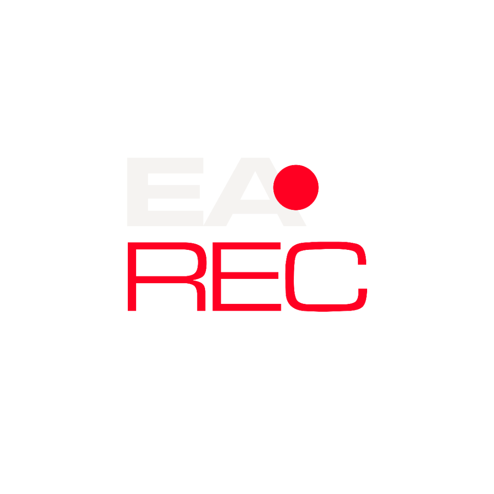

# <p align="center"><br>SELECT EA</p>

<p align="center">
  <strong>O Estúdio de Seleção e Culling de Fotos com Inteligência Artificial Local</strong><br>
  <em>Alta performance, latência zero e curadoria inteligente inspirada em ferramentas profissionais como Narrative Select e AfterShoot.</em>
</p>

<p align="center">
  
  
  
  
  
</p>

---

## ⚡ Visão Geral

O **Select EA** foi desenvolvido para resolver o maior gargalo enfrentado por fotógrafos profissionais de casamentos, ensaios e eventos: **a triagem de milhares de fotos RAW**. 

Enquanto softwares tradicionais engasgam ao carregar arquivos de 30 a 50 megapixels, o **Select EA** utiliza um pipeline híbrido ultra-otimizado:
1. **Extração de Previews em ~6ms:** Lê os cabeçalhos TIFF do arquivo RAW (`.ARW`, `.CR2`, `.CR3`, `.NEF`, `.DNG`) e extrai diretamente o JPEG Full HD embutido pela câmera, sem decodificar a matriz bruta desnecessariamente.
2. **Grade Virtualizada (Zero Latência):** Renderiza mais de 10.000 fotos com taxa constante de 60 a 120 FPS via `@tanstack/react-virtual`.
3. **Curadoria por Visão Computacional Local:** Avalia foco cravado no rosto, detecta piscadas, identifica beijos e sorrisos, e elege automaticamente a melhor foto de cada rajada (**Top Pick**).
4. **Sincronização Não Destrutiva com Lightroom & Bridge:** Grava imediatamente as notas (1 a 5 estrelas) e cores (Verde/Vermelho) em arquivos `.xmp` padrão Adobe.

---

## 🧠 Como Funciona o Motor de IA (Critérios de Avaliação)

```
[Diretório de Fotos]
        │
        ▼
[Extrator de Thumbnails RAW (~6ms)] ──► [dHash (64-bit Hash Perceptual)]
        │                                             │
        ▼                                             ▼
[Detector Facial YuNet ONNX]              [Agrupamento de Rajadas Híbrido]
        │                                 (Tempo < 3s + Similaridade Visual)
        ├─► [Micro-contraste Facial (Laplacian)]      │
        ├─► [Detector de Piscadas (Sobel Y nos Olhos)] │
        ├─► [Detector de Beijo/Pose Íntima]           ▼
        └─► [Detector de Sorrisos / Expressão] ──► [Eleição do TOP PICK]
                                                      │
                                                      ▼
                                           [Gravação Automática de XMP]
```

### 1. Foco e Nitidez Facial Real
Em vez de medir a nitidez do fundo (que em lentes claras f/1.4 ou f/2.8 é desfocado de propósito), a IA localiza a face e calcula o **micro-contraste especificamente nos olhos, cílios e textura da pele**. Foco cravado recebe entre **85% e 99%**.

### 2. Detecção de Piscadas vs. Beijo / Pose Intencional
* **Piscadas Acidentais:** A IA analisa a energia dos gradientes verticais nos olhos. Se o modelo piscou no meio do clique, a foto é rebaixada e marcada como **Rejeitada (1★ e Vermelho)**.
* **Tolerância a Beijos e Abraços:** Se dois rostos estiverem colados ou se a sequência inteira for de olhos fechados (ex: beijo no altar ou oração), a IA entende como pose intencional e **não penaliza**.

### 3. Ponderação do Sujeito Principal
Convidados desfocados a 10 metros no fundo não derrubam a nota da foto se piscarem. A decisão é 90% ponderada pela área dos sujeitos principais no primeiro plano.

### 4. Bônus de Expressão e Sorriso
A IA mede a proporção dos cantos da boca em relação à distância interpupilar, concedendo bônus de pontuação para fotos com sorrisos espontâneos.

---

## 🖥️ Modos de Visualização Profissionais

| Modo | Tecla de Atalho | Descrição |
| :--- | :---: | :--- |
| **Painel / Split View** | `S` | Grade virtualizada na esquerda com visualizador e Face Strip na direita. |
| **Grade Completa** | `G` | Aproveitamento de 100% da tela para navegar em alta velocidade (colunas ajustáveis de 2 a 6). |
| **Comparador Lado a Lado** | `C` | Exibe a foto atual selecionada **lado a lado com a foto eleita Top Pick da mesma rajada** para decidir o descarte em 1 segundo. |
| **Loupe (Tela Cheia)** | `L` | Visualizador de alta resolução com zoom 100% alternável por clique ou tecla `Espaço`. |

---

## ⌨️ Atalhos Rápidos de Teclado

* `←` / `→` : Navegar entre fotos
* `1` a `5` : Atribuir classificação por estrelas (1★ a 5★)
* `0` ou `U` : Limpar classificação
* `P` : Marcar como **Top Pick** (5★ + Etiqueta Verde)
* `X` : Marcar como **Rejeitada** (1★ + Etiqueta Vermelha)
* `6`, `7`, `8`, `9` : Atribuir etiquetas de cor XMP (Vermelho, Amarelo, Verde, Azul)
* `Barra de Espaço` : Alternar Zoom 100% / Fit
* `G` / `S` / `C` / `L` : Alternar Modos de Visualização

---

## 🚀 Como Executar

### Opção 1: Executável Autônomo / Portátil (Recomendado - Zero Instalação)
* **`Select EA.exe`**: Executável 100% autônomo com o ícone oficial embutido no arquivo. Não requer Node.js, não requer Python e funciona em qualquer versão moderna do Windows (64-bit).
* **`INICIAR_APP.bat`**: Lança o Select EA diretamente sem manter janela de terminal aberta.
* **`CRIAR_ATALHO_AREA_DE_TRABALHO.bat`**: Cria na hora um atalho na sua Área de Trabalho com a logomarca oficial e caminho dinâmico para a pasta atual (mesmo em pendrives ou unidades diferentes).

### Opção 2: IA 100% Embutida (Sem Dependência de Python)
O Select EA agora inclui o binário nativo **`ai_worker.exe`** pré-compilado via PyInstaller, com o modelo neural `yunet.onnx`, OpenCV e runtime de visão computacional embutidos. 
> **Zero Configuração:** Você não precisa instalar Python, bibliotecas ou gerenciar ambientes virtuais no computador do usuário.

### Opção 3: Modo Desenvolvedor
```bash
# Clone o repositório
git clone https://github.com/erickgomx/Select-EA.git
cd Select-EA/culling-desktop

# Instale as dependências
npm install

# Inicie o ambiente de desenvolvimento
npm run electron:dev

# Para compilar um executável portátil independente:
npm run electron:portable
```

---

## 🛠️ Pilha Tecnológica

* **Desktop Framework:** [Electron](https://www.electronjs.org/) (Processo principal com protocolo nativo de streaming `culling-thumb://` e cache LRU em RAM)
* **Frontend UI:** [React 19](https://react.dev/), [TypeScript](https://www.typescriptlang.org/), [Vite](https://vitejs.dev/)
* **Virtualização de Alta Escala:** [@tanstack/react-virtual](https://tanstack.com/virtual/latest)
* **Visão Computacional & IA:** [YuNet ONNX](https://github.com/opencv/opencv_zoo), [OpenCV](https://opencv.org/), [ONNX Runtime](https://onnxruntime.ai/)
* **Ícones & Design:** [Lucide React](https://lucide.dev/), Design System Cinema Dark Pro

---

<p align="center">
  Desenvolvido por <strong>Erick Gomes</strong> • <strong>Select EA</strong> © 2026
</p>
